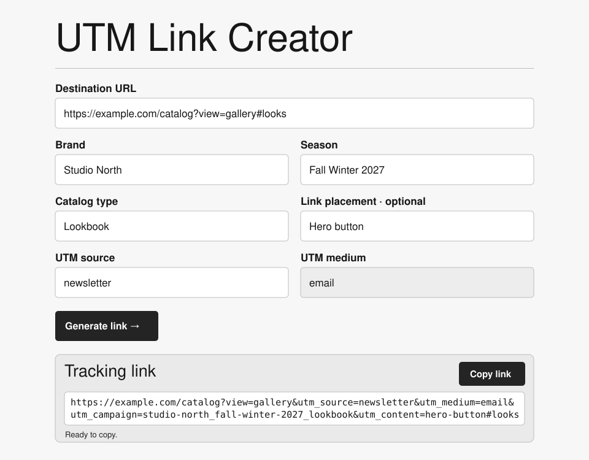

# UTM Link Creator

Tag email campaign links by brand, season, and catalog type. Paste a destination, fill in the campaign details, then generate and copy your link.

The source defaults to `newsletter`, the medium is `email`, and optional link placement becomes `utm_content`. Existing non-tracking parameters and the link fragment stay in place. No links are stored or sent.

[Open the tool](https://aaatanasi.github.io/utm-link-creator/) or open `index.html` locally. Run `node --test` to check the URL logic.
